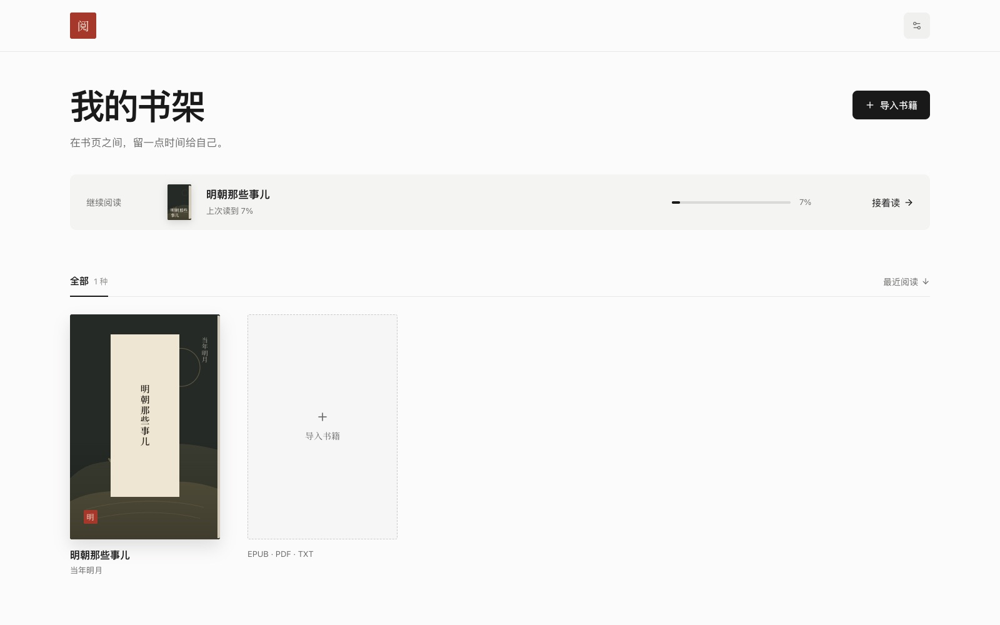
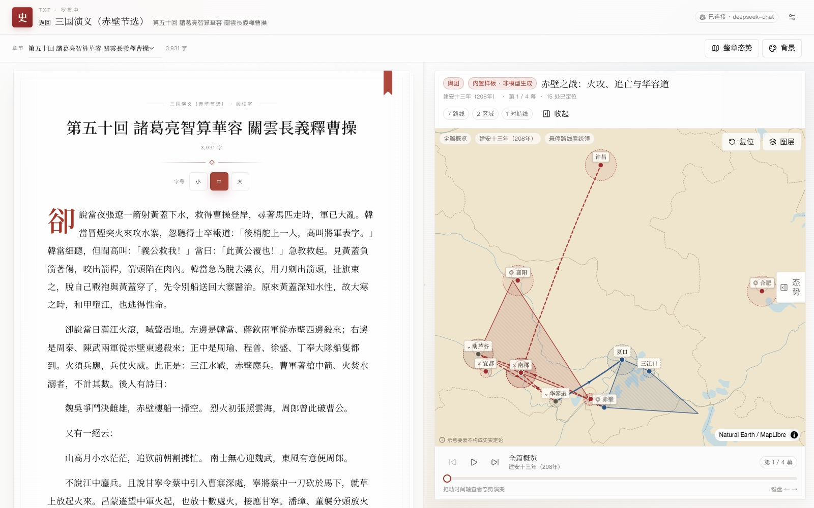
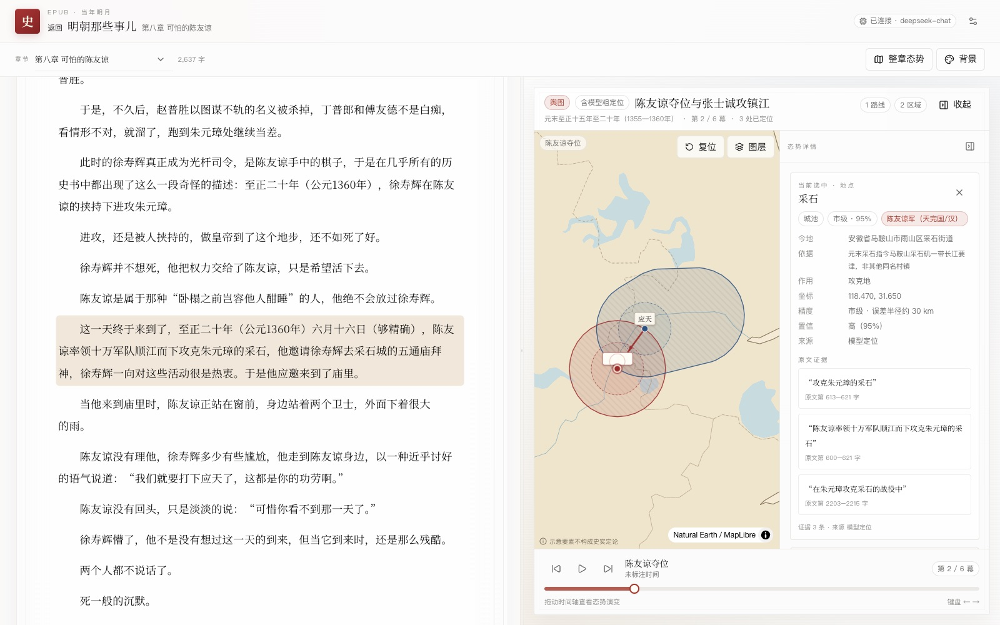
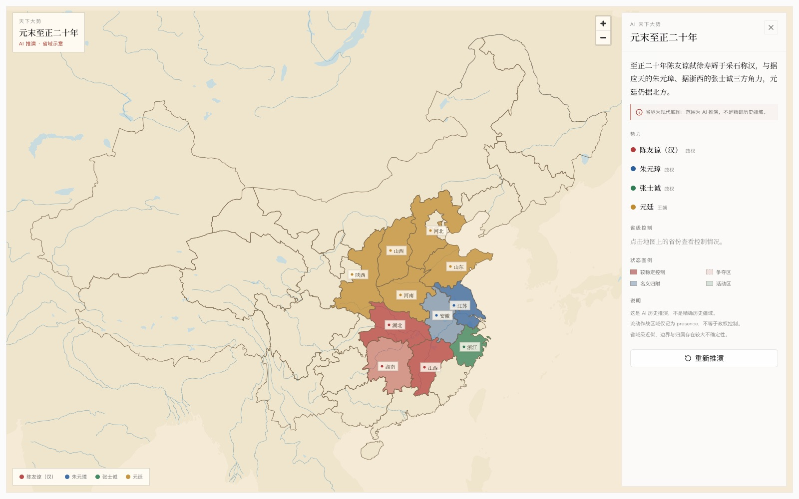

# 史地舆图 · History Atlas

把史书里的行军、对峙与城池，还原成一张能看懂的态势图。

读史时最常卡住的问题，往往不是“这个词什么意思”，而是“这件事到底发生在哪里、双方是什么态势”。**史地舆图**把选中的原文还原成四层结果：

- **地图**：势力、地点、行军路线、控制区、对峙线、时间幕；
- **叙述**：这一段发生了什么；
- **证据**：每个地图要素都能点回原文；
- **不确定性**：模型定位、低置信度、待考地名都明确标出。

> 个人项目，仍处于早期阶段。没有 API key 也可以先用内置赤壁样板和规则模式体验。

**中文** | [English](#english)

## 截图 / Screenshots

**书架 / Bookshelf**



**阅读 + 舆图 / Reader and atlas**



**点开地图要素看原文证据 / Source-linked evidence**



**天下大势 / AI overview**



## 功能

- **书架主页**：中性纸白版面、继续阅读条、五列书目网格。书封由程序生成，导入新书无需上传封面。
- **多格式导入**：EPUB、带文本层的 PDF、TXT；按章节拆分，支持中文编码识别。
- **书页式阅读**：卷首、首字下沉、页边、卷尾、章节翻页；Noto Serif SC 自托管。
- **选中即还原**：划选原文生成势力、地点、路线、控制区、对峙线与时间幕。
- **证据可追溯**：点击任一地图要素查看对应原文，阅读器同步高亮。
- **随读随切**：按当前段落自动切换态势幕；开启“阅读时自动生成”后打开章节或滚动才生成。
- **天下大势**：按当前章节年代让 AI 推演省域级势力形势，区分较稳定控制、争夺区、名义归附与活动区；这是独立的推演模式，不要求回到原文证据，并明确标注“AI 推演”。
- **模型优先定位**：地点先由模型结合书名、年代和上下文匹配现代位置；服务端校验坐标，失败才回退古地名库。
- **舆图可调**：拖动阅读器/舆图分隔条，双击复位；舆图可整栏收起。
- **全局阅读背景**：宣纸、米白、月白、陶土、竹青、夜间六套背景；夜间模式同步处理阅读器、面板和地图浮层。
- **无 key 可用**：内置《三国演义·赤壁》样板 + 规则地名标注；不会伪装成模型结果。
- **离线底图**：Natural Earth 矢量底图随仓库分发，不依赖在线瓦片。

## 技术栈

| 层 | 选型 |
| --- | --- |
| Web | Next.js 16 App Router · React 19 · TypeScript 5.9 |
| 样式 | Tailwind CSS 4 · 自托管 Noto Serif SC |
| 地图 | MapLibre GL JS 6 · 离线 GeoJSON |
| 数据 | Zod 4 · SQLite（Node 内置 `node:sqlite`，WAL） |
| 模型 | OpenAI 兼容接口（DeepSeek / OpenAI / Ollama / 自定义） |
| 测试 | Vitest · Playwright |

## 快速开始

要求 **Node.js 22.5+**、npm。

```bash
git clone https://github.com/JackLee-Zhou/History-Atlas.git
cd History-Atlas
npm install
npm run dev
```

打开 <http://127.0.0.1:3210>。

首次使用：

1. 书架为空时，点“放入赤壁示例”体验完整态势；也可以直接导入 EPUB / PDF / TXT。
2. 选一段原文，点“还原态势”。没有 key 时会使用规则模式或内置样板。
3. 需要真实生成时，打开“设置”，填写 Base URL、模型名和 API Key。

## 配置模型

设置页支持四种预设：

| 预设 | Base URL | 模型 |
| --- | --- | --- |
| DeepSeek | `https://api.deepseek.com/v1` | `deepseek-chat` |
| OpenAI | `https://api.openai.com/v1` | 账号可用模型 |
| Ollama 本地 | `http://127.0.0.1:11434/v1` | `qwen2.5:7b` 等 |
| 自定义 OpenAI 兼容 | 手动填写 | 手动填写 |

- API key **只保存在本机服务端** SQLite（`.data/history-atlas.db`），接口只返回掩码。
- key 不会进入客户端 bundle、日志、测试 fixture 或 git。
- 自定义 Base URL 指向内网/本机时，需要设置 `ALLOW_PRIVATE_LLM=1`（Ollama 预设默认允许本机）。
- 环境变量 `LLM_BASE_URL`、`LLM_MODEL`、`LLM_API_KEY` 仅作本机自动化兜底；设置页优先。

也可以复制 `.env.example` 为 `.env.local` 做首次配置，但**不要把 `.env.local` 提交到仓库**。

## 数据与隐私

- 书稿、分析结果、设置都存放在本地 `.data/`，应用本身不会上传到项目服务器。选段分析时，选中的原文会发送到你配置的模型服务商。
- `.data/`、`.env*`、测试数据库与截图产物都在 `.gitignore` 中。
- 地图坐标不是考古坐标：模型定位和地名库匹配都是近似值，界面会标注来源与置信度。
- 没有文本层的扫描 PDF 不会生成空态势，会提示换用文本版或后续 OCR。

## 常用命令

```bash
npm run dev             # 开发服务器（3210）
npm run build           # 生产构建
npm start               # 生产模式（3210）
npm run verify          # lint + typecheck + 单测 + build + 密钥扫描
npm test                # Vitest
PLAYWRIGHT_CHANNEL=chrome npm run test:e2e   # 本机系统 Chrome
npm run check:secrets   # 敏感文件/密钥扫描
npm run data:basemap    # 重新生成离线底图
npm run data:geonames   # 重新生成现代地名子集
npm run validate:assets # 校验古地名、示例书与证据偏移
```

首次跑 Playwright 时，也可以先执行 `npx playwright install chromium`。

## Docker

```bash
docker compose up -d --build
```

打开 <http://127.0.0.1:3210>。数据库保存在命名卷 `history-atlas-data` 的 `/data/history-atlas.db`。完整说明见 [Docker 部署](docs/deployment.md)。

## 架构

```text
书稿 → 抽取/分章 → 选区 → 规则初筛或模型结构化
     → 地点/路线/控制区/对峙线校验
     → 证据逐字回查 → 几何修正 → SQLite 缓存 → 阅读器 + 舆图
```

关键不变量：

- 每个地图要素至少有一条能在原文中找到的 citation，否则丢弃并记 warning；
- 模型返回的坐标必须经过服务端范围校验，不能直接信任；
- 地点少于两处时仍渲染底图和已有要素；
- 不确定的定位显式标“待考/低置信/模型定位”，不要求用户逐个手动标注。

更多设计见 [架构](docs/architecture.md)、[契约](docs/contracts.md) 和 [分析管道](docs/ai-pipeline.md)。

## 目录

```text
app/                 页面与 API 路由
components/          阅读器、舆图、书架、设置、UI
lib/schema/          Zod 契约
lib/server/          SQLite、设置、HTTP、SSE
lib/extraction/      EPUB / PDF / TXT 抽取
lib/gazetteer/       古地名与现代地名匹配
lib/pipeline/        分析管道与校验
lib/llm/             模型 provider
lib/prompts/         版本化提示词
assets/              古地名、现代地名、示例书与样板
public/basemap/      离线矢量底图
scripts/             数据生成、构建与密钥检查
tests/               Vitest / Playwright
docs/                架构、阅读器、数据源、部署、设计
.data/               （运行时）SQLite 数据库，已忽略
```

## 已知限制

- 冷僻古地名、同名异地、政区沿革可能匹配失败；失败会进入“待考”。
- 首版使用现代底图，历史海岸线/政区边界不精确。
- 不支持扫描件 OCR、竖排自动识别、原生 App、账号/云同步。
- 模型效果依赖书、章节和服务商；真实评估记录见 [eval](docs/eval.md)。
- 单实例 SQLite 应用，不支持多实例并发写；后续可迁移 PostgreSQL。

## 文档

- [架构](docs/architecture.md)
- [数据契约](docs/contracts.md)
- [阅读器与导入](docs/reader.md)
- [天下大势（AI 省域推演）](docs/overview.md)
- [分析管道](docs/ai-pipeline.md)
- [数据来源与许可](docs/data-sources.md)
- [底图与现代地名](docs/data-sources-geo.md)
- [内置演示数据](docs/data-sources-demo.md)
- [界面设计](docs/design.md)
- [Docker 部署](docs/deployment.md)
- [已知问题](docs/known-issues.md)

## English

History Atlas is a local-first reading and spatial-reconstruction workspace for historical texts. Import a book, read it as a paginated volume, select a passage, and turn it into an interactive situation map with factions, places, routes, control areas, and front lines. Every map feature links back to a source quote; uncertain locations are explicitly marked.

Books, analysis caches, and model settings live in local SQLite—no account or cloud sync required. Without an API key, the built-in Red Cliffs sample and rule-based mode are still available.

**Highlights**

- EPUB / PDF / TXT import with chapter-aware reading
- Passage-to-map reconstruction: factions, places, routes, control areas, front lines
- Source-linked evidence for every map feature
- Model-first geocoding with gazetteer fallback and uncertainty markers
- Map scenes follow the reading position
- Offline basemap, night mode, draggable reader/map split
- OpenAI-compatible providers: DeepSeek, OpenAI, Ollama, custom endpoints

**Quick start**

```bash
git clone https://github.com/JackLee-Zhou/History-Atlas.git
cd History-Atlas
npm install
npm run dev
```

Open <http://127.0.0.1:3210>. Node.js 22.5+ is required.

**License**

MIT. Copyright (c) 2026 Jack Lee. Commercial use is permitted; keep the copyright and license notice.

## 许可

代码采用 [MIT License](LICENSE)，版权人 **Jack Lee**。

你可以自由使用、修改、分发，也可以用于商业项目，只需保留版权与许可声明。

第三方数据、底图、字体和示例文本的许可见 [NOTICE](NOTICE) 与 [docs/data-sources.md](docs/data-sources.md)。
